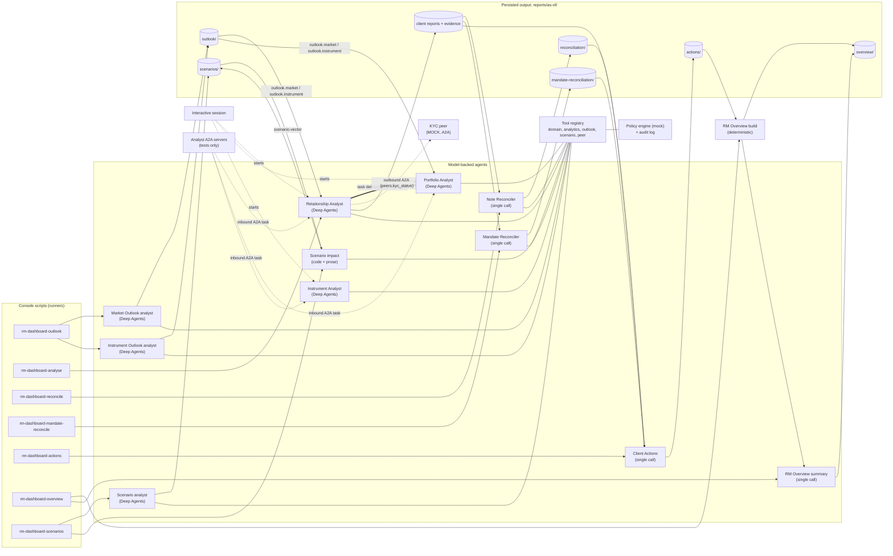
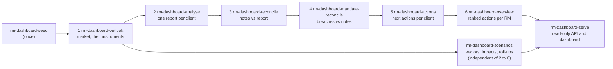
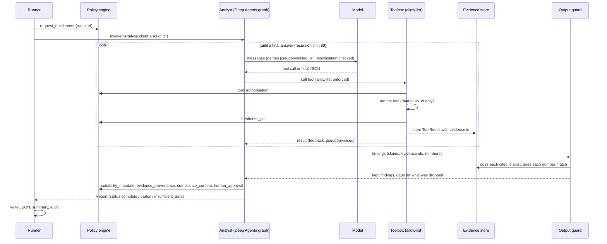
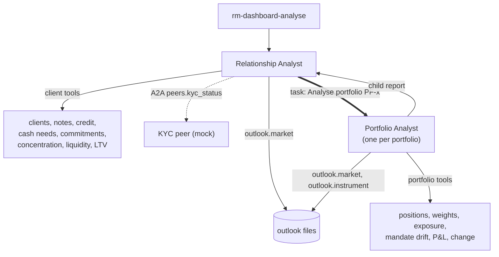
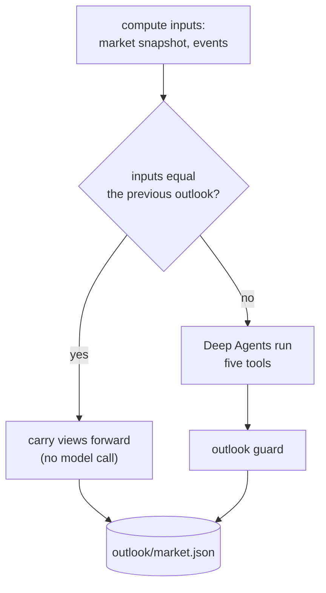
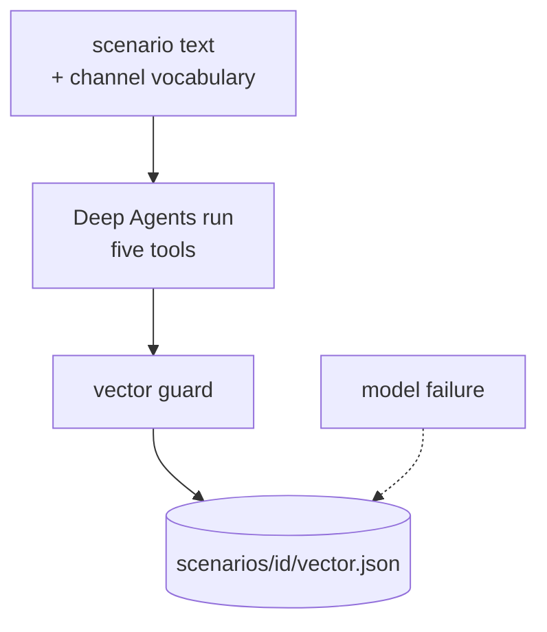
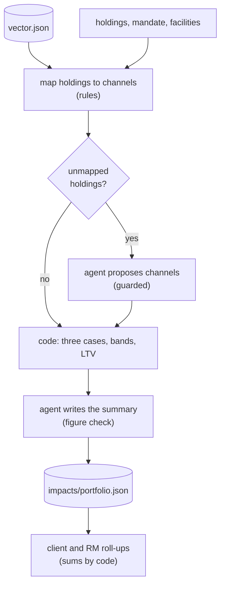
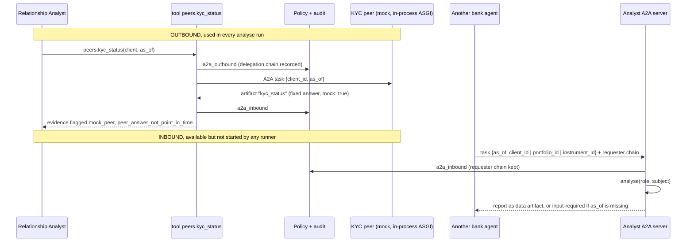

# Architecture: agents, runners, tools and agent-to-agent calls

This is the map of the agent landscape. It starts with the whole picture and then breaks down: the runners that call
the agents, one section per agent, the tools each agent may use and the agent-to-agent (A2A) communication. The rules of
each stage are in [agents.md](agents.md), the calculations and every tool in [methods.md](methods.md), the policy layer in
[policy-checkpoints.md](policy-checkpoints.md) and the output contracts in [contracts.md](contracts.md).

Tests keep this page in step with the code (`tests/test_docs.py`): every agent role, console script, registered tool,
allow-list entry and agent-card skill must appear here.

## 1. Overview

### 1.1 What kinds of agent there are

Not every "agent" is the same kind of thing. Four setups exist, and the section of each agent states which it is.

| Agent | Setup | Model-backed | Triggered by | Output |
|---|---|---|---|---|
| Relationship Analyst | Deep Agents graph with tool loop; delegates portfolios | yes | `rm-dashboard-analyse`, sessions, A2A | `reports/<as-of>/<client>.json` |
| Portfolio Analyst | Deep Agents graph with tool loop | yes | the Relationship Analyst (delegation), sessions, A2A | a child report inside the client report |
| Instrument Analyst | Deep Agents graph with tool loop | yes | sessions and A2A only (no runner) | a report, on request |
| Note Reconciler | Single model call; notes read through a tool in code | yes | `rm-dashboard-reconcile` | `reconciliation/<client>.json` |
| Mandate Reconciler | Single model call; breaches computed earlier, status guarded in code | yes | `rm-dashboard-mandate-reconcile` | `mandate-reconciliation/<client>.json` |
| Client Actions | Single model call; rubric, merge, horizons in code | yes | `rm-dashboard-actions` | `actions/<client>.json` |
| RM Overview | Deterministic build; one optional summary call | summary only | `rm-dashboard-overview` | `overview/<rm_id>.json` |
| Market Outlook analyst | Deep Agents graph with tool loop; carry-forward without a call | yes | `rm-dashboard-outlook` | `outlook/market.json` |
| Instrument Outlook analyst | Same agent as above with another prompt and tool set | yes | `rm-dashboard-outlook` | `outlook/instruments/<id>.json` |
| Scenario analyst | Deep Agents graph with tool loop; code guards every move | yes | `rm-dashboard-scenarios` | `scenarios/<id>/vector.json` |
| Scenario impact | Computed by code; the same agent setup places unmapped holdings and writes the summaries | yes (prose and placement only) | `rm-dashboard-scenarios` | `scenarios/<id>/impacts/<portfolio>.json`, `clients/<client>.json`, `rollup.json` |
| KYC peer | Mock: a scripted A2A executor | no | the Relationship Analyst, over A2A | an answer, not a file |

The four setups:

- **Deep Agents graph with tool loop.** Built by `build_agent` (`agents/analyst.py`) with `create_deep_agent`: a LangGraph
  loop where the model chooses among allow-listed tools, wrapped by `AllowListMiddleware` (the model sees only the
  allow-list and `task`), `PrivacyMiddleware` (pseudonymises every model call) and `NoSummarizationMiddleware`. An
  analyst may have delegates, which appear as a `task` sub-agent.
- **Single model call with code around it.** The facts are put in the prompt, the model answers once with JSON, and a
  guard in code checks the answer. There is no tool loop; where data is needed it is read by code before the call.
- **Deterministic code.** No model decides content, order or links.
- **Mock.** A stand-in that returns scripted answers and says so in the evidence.

The model itself is the same everywhere: `build_model(settings)` gives a gateway model, or the scripted `StubChatModel`
when `RM_MODEL_NAME=stub`, which is the default (see section 6).

### 1.2 The landscape

How to read it:

| Edge | Meaning |
|---|---|
| `-->` thin arrow | a runner starts an agent, or an agent reads or writes a persisted file |
| `==>` thick arrow | in-process delegation: the Relationship Analyst runs the Portfolio Analyst through the `task` tool, in the same run and policy scope |
| `-.->` dotted arrow | agent-to-agent protocol, or an interactive session starting an analyst |
| `---` line to Tool registry | the agent calls tools through its allow-list (section 5) |

Persisted files are the only link between the batch stages: each stage reads what the previous one wrote and does not call
it. That is why the stages can be re-run independently, and why a missing earlier file is a gap and not a crash.

### 1.3 Pipeline order

`outlook` runs first because the client analysis reads its files. `analyse` writes the report and evidence; `reconcile`
reads both; `mandate-reconcile` reads the evidence's computed mandate, position-limit and exclusion breaches and the notes; `actions` reads the report, the evidence and, when present, the note and mandate reconciliations; `overview` reads the actions.
`scenarios` reads only the database and the scenario catalogue; it can run at any time and the API serves its files next to the rest.
Each command takes `--as-of` (required) and saves its results in the artifact store (`reports/artifacts.db` by default; see README), under that date.

**Artifact addresses.** Generated output is stored as artifacts addressed by `(as_of, kind, key)`, not as files. Where this document
writes a path such as `reports/<as-of>/<client>.json` or `reconciliation/<client>.json`, read the artifact it names:

| Older path | Kind | Key |
|---|---|---|
| `<client>.json` | `report` | `<client>` |
| `evidence/<client>.json` | `evidence` (one record per tool result) and `evidence-index` | `<evidence_id>`; `report/<client>` |
| `reconciliation/`, `mandate-reconciliation/`, `actions/<client>.json`; `overview/<rm_id>.json` | `reconciliation`, `mandate-reconciliation`, `actions`, `overview` | `<client>`; `<rm_id>` |
| `outlook/market.json`; `outlook/instruments/<id>.json` | `outlook-market`; `outlook-instrument` | `market`; `<id>` |
| `scenarios/<id>/vector.json`, `impacts/<pf>.json`, `clients/<cl>.json`, `rollup.json` | `scenario-vector`, `scenario-impact`, `scenario-client`, `scenario-rollup` | `<id>`; `<id>/<pf>`; `<id>/<cl>`; `<id>` |
| `scenarios/catalogue.json` (no date) | `scenario-catalogue` | `catalogue` |
| `summary.json` | `run-summary` | the stage: `analyse`, `reconcile`, `mandate-reconcile`, `actions`, `overview`, `outlook`, `scenarios` |
| `audit.jsonl` | `audit` (one record per entry) | `<stage>/<seq>` |

The backend is SQLite (`reports/artifacts.db`) or Firestore; code reaches it only through `rm_dashboard.store`.

## 2. Runners

Runners are the only callers of the batch agents. Each is a console script from `[project.scripts]` in `pyproject.toml`.

| Command | Function | Calls (model role) | Subject and parallelism | Reads | Writes |
|---|---|---|---|---|---|
| `rm-dashboard` | `rm_dashboard:main` | none | prints a greeting | none | none |
| `rm-dashboard-seed` | `data.seed:main` | none | loads the CSV and JSON data into SQLite | `sample/.../data` | `rm.db` |
| `rm-dashboard-load` | `loader.cli:main` | none | `source`: the dataset files into SQLite or Firestore; `artifacts`: artifacts (or an older `reports/` folder) into SQLite or Firestore | dataset files, artifact store or `reports/` folder | `rm.db` or Firestore, `artifacts.db` or Firestore |
| `rm-dashboard-serve` | `api.serve:main` | none | read-only HTTP API | `rm.db`, artifact store | none |
| `rm-dashboard-outlook` | `runners.outlook:run_outlook` | `outlook_analyst` (market, then per instrument) | one market outlook, then one per held instrument, thread pool of `max_concurrency` | `rm.db`, earlier outlooks | `outlook/market.json`, `outlook/instruments/<id>.json`, evidence, `summary.json`, `audit.jsonl` (append-only) |
| `rm-dashboard-scenarios` | `runners.scenarios:run_scenarios` | `scenario_analyst` (one per scenario), `scenario_impact` (per portfolio x scenario, then client and RM summaries) | units in a thread pool of `max_concurrency`; `--scenario`, `--portfolio` filters, `--force` | `rm.db`, `reports/scenarios/catalogue.json` | `scenarios/<id>/vector.json`, `impacts/<portfolio>.json`, `clients/<client>.json`, `rollup.json`, evidence, `scenarios/summary.json`, `scenarios/audit.jsonl` (append-only) |
| `rm-dashboard-analyse` | `runners.batch:run_batch` | `relationship_analyst` (which delegates to `portfolio_analyst`) | one run per client, thread pool | `rm.db`, outlooks | `<client>.json`, `evidence/<client>.json`, `summary.json`, `audit.jsonl` |
| `rm-dashboard-reconcile` | `runners.reconcile:run_reconcile` | `note_reconciler` | one call per client, thread pool | client report and evidence, notes | `reconciliation/<client>.json`, `summary.json`, `audit.jsonl` |
| `rm-dashboard-mandate-reconcile` | `runners.mandate_reconcile:run_mandate_reconcile` | `mandate_reconciler` | one call per client with breaches and notes, thread pool | client report and evidence (breaches), notes | `mandate-reconciliation/<client>.json`, `summary.json`, `audit.jsonl` |
| `rm-dashboard-actions` | `runners.actions:run_actions` | `client_actions` | one call per client, thread pool | client report and evidence, reconciliation | `actions/<client>.json`, `summary.json`, `audit.jsonl` |
| `rm-dashboard-overview` | `runners.overview:run_overview` | `rm_overview_summary` (after a deterministic build) | one overview per RM, sequential | `actions/` of the RM's clients | `overview/<rm_id>.json`, `summary.json`, `audit.jsonl` |

What every agent runner does the same way:

1. Reads `Settings.from_env()` and the arguments (`--as-of` required, `--db` or `RM_DASHBOARD_DB`, `--artifact-store` or `RM_ARTIFACT_STORE` (the older `--reports-dir` names the folder holding `artifacts.db`),
   `--concurrency`, which overrides `RM_MAX_CONCURRENCY`). The code default is 2; some `--help` texts say 4.
2. Opens the tool registry through `wiring.open_registry`: SQLite data source, point-in-time repository and, unless
   disabled, the in-process **mock** KYC peer (section 6).
3. Builds the model per role with `build_model(settings, role=...)`.
4. Runs one subject per task in a thread pool of `max_concurrency` workers. A failure on one subject never stops the
   others: an exception becomes a `partial` result with an `agent_error` gap.
5. Saves one artifact per subject, a run summary with status counts, and the audit trail, all in the artifact store.
6. Is re-runnable: `analyse`, `reconcile`, `actions` and `overview` overwrite their files; `outlook` carries forward
   unchanged views and leaves an existing outlook of the same date alone unless `--force`; `scenarios` skips every unit whose input hash
   is unchanged, writes each unit as soon as it is done and resumes after an interruption.

## 3. How an agent runs and is called

### 3.1 One analysis run

This is the path of a model-backed analyst in the batch (`analyse`). The single-call stages follow the same outer shape
(policy, privacy, model, guard, assembly) without the tool loop.

The model never sees a date parameter and cannot choose one: `as_of` belongs to the run. The model proposes; code
decides what survives. A run always returns a report: a tool failure, policy denial, model error or unparsable answer
becomes a gap and a lower status.

### 3.2 Ways to call an agent

| Way | What starts it | Agents reachable |
|---|---|---|
| Batch runner | a console script | all stages except the Instrument Analyst |
| In-process delegation | the Relationship Analyst's `task` tool, matching a portfolio id in the request | Portfolio Analyst |
| Interactive session | `AnalystSession(role, subject, scope, models)`: `start()`, `ask()`, `set_as_of()` | Relationship, Portfolio, Instrument analysts |
| A2A server | an inbound protocol task with `as_of` and a client, portfolio or instrument id | the same three analysts, through `create_analyst_app` (tests only today) |

## 4. The agents

Each section has the same fields: purpose, setup, subject and trigger, inputs and tools, delegation and callers, output
and file, checks after the model, and model used. The "called by" line names the runner.

### 4.1 Relationship Analyst (`relationship_analyst`)

- **Purpose:** the RM's view of one client: profile and KYC, concentration across all portfolios with look-through,
  liquidity against needs and commitments, credit and collateral, what the RM notes say, and the market outlook.
- **Setup:** Deep Agents graph with a tool loop (`ANALYSTS["relationship_analyst"]`), prompt `RELATIONSHIP_ANALYST`,
  one delegate: `portfolio_analyst`.
- **Subject and trigger:** a client id (`CL-xxxx`) and `as_of`. Called by `rm-dashboard-analyse`; also by sessions and A2A.
- **Inputs and tools:** 18 tools (section 5), including `notes.list`, the outlook tool `outlook.market` and the A2A tool
  `peers.kyc_status`.
- **Delegation and callers:** delegates each portfolio to the Portfolio Analyst through the `task` tool; the child runs
  in the same scope and the original requester chain is kept. Calls the KYC peer over A2A.
- **Output and file:** `Report` in `reports/<as-of>/<client>.json` with the child portfolio reports under `children`,
  plus `evidence/<client>.json`.
- **Checks after the model:** the output guard drops any finding that cites evidence not produced in the run or contains
  a number not in the cited evidence (tolerance 0.5% relative or the displayed rounding); gaps are collected; status is
  derived; policy checkpoints run at assembly.
- **Model used:** the configured model (`RM_MODEL_NAME`), or the scripted stub.

### 4.2 Portfolio Analyst (`portfolio_analyst`)

- **Purpose:** composition, mandate band breaches (custody accounts are not measured against a mandate), unrealised P&L,
  change since an earlier snapshot, and the bank's view of the largest positions.
- **Setup:** Deep Agents graph with a tool loop, no delegates. It no longer delegates to the Instrument Analyst; it reads
  the persisted instrument outlooks.
- **Subject and trigger:** a portfolio id (`PF-xxxx`) and `as_of`. Called by the Relationship Analyst; also sessions and A2A.
  No runner starts it on its own.
- **Inputs and tools:** 13 tools, including `analytics.mandate_drift`, `analytics.exclusion_breaches`, `outlook.market` and `outlook.instrument`.
- **Delegation and callers:** none outward; called by the Relationship Analyst.
- **Output and file:** a `Report` returned to the parent and stored in its `children`.
- **Checks after the model:** the same output guard; a missing outlook is a gap, not a failure.
- **Model used:** the configured model or the stub.

### 4.3 Instrument Analyst (`instrument_analyst`)

- **Purpose:** reference data, price path, events and market context for one instrument.
- **Setup:** Deep Agents graph with a tool loop. It is kept for interactive use and A2A.
- **Subject and trigger:** an instrument id (`SYN-xx-nnnn`) and `as_of`. **No runner calls it.** It is reached only through
  interactive sessions or the protocol. The batch uses the Instrument Outlook analyst (4.8) instead.
- **Inputs and tools:** 6 tools, including `analytics.risk` and `instruments.prices`.
- **Delegation and callers:** none.
- **Output and file:** a `Report`, returned to the caller.
- **Checks after the model:** the same output guard.
- **Model used:** the configured model or the stub.

### 4.4 Note Reconciler (`note_reconciler`)

- **Purpose:** checks what the RM's notes say about a client against what the client's report shows.
- **Setup:** single model call with code around it. It is not a tool-calling agent: code reads the notes through the
  `notes.list` tool (so point-in-time, policy and audit apply), puts notes and report findings into the prompt, and calls
  the model once per client.
- **Subject and trigger:** a client id and `as_of`. Called by `rm-dashboard-reconcile`.
- **Inputs and tools:** the persisted report and evidence of the client; the notes. One tool: `notes.list`.
- **Delegation and callers:** none.
- **Output and file:** `reconciliation/<client>.json`: one verdict per note (`consistent`, `contradicted`,
  `unverifiable`) with the quoted note, rationale, finding refs and evidence ids.
- **Checks after the model:** `reconciliation/guard.py`: references must resolve to this client's findings; evidence ids are
  copied from those findings; a verdict without resolvable evidence becomes `unverifiable`; a figure in the rationale
  must appear in the evidence or the note; a skipped note is added as `unverifiable`. Names are pseudonymised.
- **Model used:** the configured model or the stub.

### 4.4.1 Mandate Reconciler (`mandate_reconciler`)

- **Purpose:** gives each computed mandate, position-limit and exclusion breach of a client one status from what the RM's notes say about it: `no_note`, `acknowledged`, `client_directed` or `contradicted`.
- **Setup:** single model call with code around it. The breaches are read from the persisted evidence (`analytics.mandate_drift`, `analytics.exclusion_breaches`), never from the model or a note; code reads the notes through `notes.list`. No model call when the client has no breach or no note up to `as_of`.
- **Subject and trigger:** a client id and `as_of`. Called by `rm-dashboard-mandate-reconcile`.
- **Inputs and tools:** the persisted report and evidence of the client; the notes. One tool: `notes.list`.
- **Delegation and callers:** none.
- **Output and file:** `mandate-reconciliation/<client>.json`: one result per breach with status, rationale, the quoted notes, the breach's evidence id and whether a waiver is claimed; `ambiguous_notes`; gaps.
- **Checks after the model:** `mandate_reconciliation/guard.py`: a breach the system did not compute is dropped; a status other than `no_note` needs the breach's own evidence id and a cited note dated on or before `as_of`, and its figures must appear in the evidence or the note, otherwise it is reset to `no_note` with a gap; a client with several managed portfolios has a note applied only where it names the asset class, instrument or portfolio, otherwise it is listed as ambiguous. A waiver is stated as the RM's claim. Names are pseudonymised.
- **Model used:** the configured model or the stub.

### 4.5 Client Actions (`client_actions`)

- **Purpose:** decides the next actions for one client from the report findings and the note reconciliation.
- **Setup:** single model call. No tools. Everything after the call is code: guard, merge of duplicates, the importance
  rubric (a floor the model cannot go below), horizons derived from dates in the evidence, ordering and rank.
- **Subject and trigger:** a client id and `as_of`. Called by `rm-dashboard-actions`.
- **Inputs and tools:** findings, reconciled notes and quality flags of the client. No tools.
- **Delegation and callers:** none.
- **Output and file:** `actions/<client>.json`.
- **Checks after the model:** `actions/guard.py` keeps valid categories and importances, references that exist for this
  client, and figures found in the linked content; evidence ids come from that content, never from the model; the
  rubric raises importance to its floor.
- **Model used:** the configured model or the stub.

### 4.6 RM Overview (`rm_overview_summary`)

- **Purpose:** one ranked list of next actions across an RM's clients, with an optional short briefing.
- **Setup:** deterministic build (`overview/build.py`: ranking by importance, horizon, due date and client size; grouping
  by category; links). One optional model call writes the summary and themes (`overview/summary.py`).
- **Subject and trigger:** an RM id and `as_of`. Called by `rm-dashboard-overview`; one RM at a time.
- **Inputs and tools:** the persisted client actions. No tools.
- **Delegation and callers:** none. With no actions, no model is called.
- **Output and file:** `overview/<rm_id>.json`.
- **Checks after the model:** `guard_summary` drops claims with unsupported numbers; the summary can never change the
  actions or their order; a failed summary is a gap and never blocks the overview.
- **Model used:** the configured model or the stub, for the summary only.

### 4.7 Market Outlook analyst (`outlook_analyst`)

- **Purpose:** the bank's house view of the market, independent of clients: a direction, horizon and confidence per
  segment, with cited drivers and risks.
- **Setup:** Deep Agents graph with a tool loop (`outlook/agent.py`, `SPEC`); five tools. When no new data has arrived
  since the previous outlook, the views are carried forward **without a model call**.
- **Subject and trigger:** the market at `as_of`. Called by `rm-dashboard-outlook` once.
- **Inputs and tools:** `market.history`, `analytics.market_trend`, `events.list`, `news.list`, `outlook.previous_market`.
- **Delegation and callers:** none.
- **Output and file:** `outlook/market.json` and its evidence.
- **Checks after the model:** `outlook/guard.py`: values from closed sets; every driver and risk must cite evidence of this
  run; unsupported figures are blanked; the change kind is derived by code; a direction change needs newer evidence;
  confidence is capped.
- **Model used:** the configured model or the stub.

### 4.8 Instrument Outlook analyst (`outlook_instrument`)

- **Purpose:** the house view of one instrument against its peers, the events that bear on it and the market outlook.
- **Setup:** the same Deep Agents agent as 4.7 with another prompt and a narrower allow-list (`outlook_instrument`).
  Computed once per instrument and date, with the same carry-forward rule.
- **Subject and trigger:** an instrument id and `as_of`. Called by `rm-dashboard-outlook` for every instrument held in
  any portfolio, or the ones named with `--instruments`.
- **Inputs and tools:** `instruments.context`, `events.relevant`, `outlook.market`, `outlook.previous_instrument`.
- **Delegation and callers:** none; the market segments that bear on the instrument are copied from the market outlook by
  code, not written by the model.
- **Output and file:** `outlook/instruments/<id>.json` and its evidence.
- **Checks after the model:** the guard of 4.7, plus confidence caps while risk statistics are unavailable for lack of history.
- **Model used:** the configured model or the stub.

### 4.8.1 Scenario analyst (`scenario_analyst`)

- **Purpose:** how the markets would move over the scenario's horizon if the scenario happened: a best, likely and worst
  percentage move per market channel, with rationale, explainer, cited evidence and an anchoring past event. Independent of any
  client; the moves are conditional, not forecasts or probabilities.
- **Setup:** Deep Agents graph with a tool loop (`scenarios/agent.py`, `SPEC`); five tools. One run per scenario and date; the
  result is cached by an input hash and shared by every portfolio.
- **Subject and trigger:** a scenario id (stored text: premise, mirrored event, horizon) and `as_of`. Called by
  `rm-dashboard-scenarios` once per scenario.
- **Inputs and tools:** `market.history`, `analytics.market_trend`, `market.snapshot`, `events.list`, `news.list`. The request lists
  the channel vocabulary derived from the instruments in the data.
- **Delegation and callers:** none.
- **Output and file:** `scenarios/<id>/vector.json` and `scenarios/<id>/evidence/vector.json`.
- **Checks after the model:** `scenarios/guard.py`: moves keyed to a single instrument or to an unreachable channel are removed; a
  move needs evidence of this run and its date; figures in its text must be in that evidence or be one of its moves; values are
  reordered by code to worst <= likely <= best; an anchor must be an event the run returned; a model failure gives a vector
  without channels.
- **Model used:** the configured model or the stub.

### 4.8.2 Scenario impact (`scenario_impact`)

- **Purpose:** what a scenario does to one portfolio, and the words around it. **Every figure is computed by code** (section 9 of
  [methods.md](methods.md)); the agent places the few holdings the rules cannot map onto channels and writes the summary.
- **Setup:** `scenarios/impact.py` (arithmetic, bands, LTV) and `scenarios/writer.py` (the same Deep Agents setup with another prompt
  and allow-list, asked one task at a time: `mapping`, `summary`, `client_summary`, `rm_summary`).
- **Subject and trigger:** a portfolio and a scenario at `as_of`, run by `rm-dashboard-scenarios` after the vector; then one client
  summary per client and one RM-book summary per scenario.
- **Inputs and tools:** `scenario.vector`, `portfolios.get`, `positions.list`, `instruments.get`, `analytics.exposure`,
  `analytics.mandate_drift`, `credit.facilities`. The computed figures are given in the request.
- **Delegation and callers:** none.
- **Output and file:** `scenarios/<id>/impacts/<portfolio>.json` (three cases, bands, collateral, positions with channels, summary,
  explainers, gaps), `clients/<client>.json`, `rollup.json`.
- **Checks after the model:** a mapping is accepted only for a holding the rules could not place, onto channels of the vector, never
  fx, with a reason; a summary is accepted only if every figure it quotes equals a computed value and it does not turn a gain into
  a loss, otherwise a summary built by code replaces it. A model failure costs the prose, never the figures.
- **Model used:** the configured model or the stub.

### 4.9 KYC peer (mock)

- **Purpose:** stands in for the bank's KYC and compliance system.
- **Setup:** **mock**. `MockKycExecutor` (`a2a/mock_peer.py`) is a scripted A2A executor that answers every client with
  "no adverse findings" and "sanctions and PEP screening clear". It has no model and no data. Evidence from it carries the
  flags `mock_peer` and `peer_answer_not_point_in_time`.
- **Subject and trigger:** a client id and `as_of`, from the Relationship Analyst's tool `peers.kyc_status`.
- **Inputs and tools:** none.
- **Delegation and callers:** called by the Relationship Analyst, over A2A, in-process (section 6).
- **Output and file:** an A2A data artifact, recorded as evidence sourced to the peer; no file.
- **Checks after the model:** not applicable (no model). Policy checkpoints and audit apply to the call.
- **Model used:** none. It is the same answer whatever model is configured.

## 5. Tools and who may call them

Agents have no data access except through tools. A tool is registered once (`ToolRegistry`), has a kind, and is exposed to
an agent only if it is on that agent's allow-list (`tools/allowlists.py`). A call outside the list is refused. Every call
passes the `tool_authorisation` and `freshness_pit` checkpoints and is audited, and every result is an evidence envelope
with an id the agent must cite. Kinds: `domain` (data reads), `analytics` (deterministic calculations), `outlook`
(read-only access to persisted outlooks), `scenario` (read-only access to stored shock vectors) and `peer` (A2A).

Client Actions, the RM Overview and the Note Reconciler's model have no tools. The Note Reconciler's single tool is read by
code, not chosen by the model. A blank row means the tool is registered and on no allow-list.

| Tool | Kind | Purpose | Relationship | Portfolio | Instrument | Note reconciler | Market outlook | Instrument outlook | Scenario analyst | Scenario impact |
|---|---|---|---|---|---|---|---|---|---|---|
| `analytics.change` | analytics | Change in portfolio value between two dates decomposed into price, FX and flow. |  | x |  |  |  |  |  |  |
| `analytics.collateral_funding` | analytics | Whether a client's needs can be funded without breaching the facility when collateral is pledged. | x |  |  |  |  |  |  |  |
| `analytics.concentration` | analytics | Client-level concentration across portfolios with look-through, HHI and top-N. | x |  |  |  |  |  |  |  |
| `analytics.credit_ltv` | analytics | Loan-to-value, headroom to trigger and cure amount for a facility. | x |  |  |  |  |  |  |  |
| `analytics.exclusion_breaches` | analytics | Held instruments flagged sustainability_excluded in a mandate with binding exclusions, direct and through structured products; custody portfolios are not applicable. |  | x |  |  |  |  |  |  |
| `analytics.exposure` | analytics | Portfolio exposure by asset_class, currency, sector or region. |  | x |  |  |  |  |  | x |
| `analytics.liquidity` | analytics | Liquid assets against planned needs and uncalled commitments within a horizon. | x |  |  |  |  |  |  |  |
| `analytics.mandate_drift` | analytics | Asset-class weights against mandate bands; custody portfolios are not applicable. |  | x |  |  |  |  |  | x |
| `analytics.market_trend` | analytics | Level and change of every market series against the previous and the first snapshot. |  |  |  |  | x |  | x |  |
| `analytics.pnl` | analytics | Unrealised profit and loss of a portfolio, excluding positions without cost basis. |  | x |  |  |  |  |  |  |
| `analytics.risk` | analytics | Volatility, VaR, drawdown or Sharpe; insufficient_history when the series is too short. |  |  | x |  |  |  |  |  |
| `analytics.weights` | analytics | Position weights of a portfolio, with the denominator stated. |  | x |  |  |  |  |  |  |
| `cash_needs.list` | domain | Planned cash needs of a client with stated certainty. | x |  |  |  |  |  |  |  |
| `clients.get` | domain | Client profile as of a date. Unversioned attributes are tagged current_only. | x |  |  |  |  |  |  |  |
| `clients.list` | domain | Clients that exist at a date, with a few identifying fields. |  |  |  |  |  |  |  |  |
| `commitments.list` | domain | Private-markets commitments of a client. | x |  |  |  |  |  |  |  |
| `credit.facilities` | domain | Credit facilities of a client with figures per snapshot up to as_of. | x |  |  |  |  |  |  | x |
| `events.list` | domain | Curated dated events up to as_of. | x | x | x |  | x |  | x |  |
| `events.relevant` | domain | Events dated up to as_of that may bear on one instrument (region, sector, asset class, name or underlying), each with what it matched on. Candidates only. |  |  |  |  |  | x |  |  |
| `instruments.context` | domain | Instrument reference data, price path across snapshots, peers with relative performance, and which risk statistics the history allows. |  |  |  |  |  | x |  |  |
| `instruments.get` | domain | Instrument reference data. |  | x | x |  |  |  |  | x |
| `instruments.prices` | domain | Instrument price history, one row per snapshot up to as_of. |  |  | x |  |  |  |  |  |
| `market.history` | domain | Market series (indices, rates, FX, commodities) at every snapshot up to the effective one. |  |  |  |  | x |  | x |  |
| `market.snapshot` | domain | Market series (indices, rates, FX, commodities) at the effective snapshot. | x | x | x |  |  |  | x |  |
| `news.list` | domain | News for the period: dated market-moving events from the curated event log, up to as_of. No external news feed yet. | x |  | x |  | x |  | x |  |
| `notes.list` | domain | Relationship-manager notes up to as_of, as dated quoted text. | x |  |  | x |  |  |  |  |
| `outlook.instrument` | outlook | The outlook of one instrument for the run's date (the latest one not after it), as the bank's view with its date. |  | x |  |  |  |  |  |  |
| `outlook.market` | outlook | The market outlook for the run's date (the latest one not after it), as the bank's view with its date. | x | x |  |  |  | x |  |  |
| `outlook.previous_instrument` | outlook | The latest earlier outlook of one instrument, as a reference view only (never support for a driver or risk). |  |  |  |  |  | x |  |  |
| `outlook.previous_market` | outlook | The latest earlier market outlook, as a reference view only (never support for a driver or risk). |  |  |  |  | x |  |  |  |
| `parties.get` | domain | The client as a party (individual or organisation) with its relationships list. | x |  |  |  |  |  |  |  |
| `peers.kyc_status` | peer | KYC and compliance status of a client from the bank's KYC peer agent (A2A). | x |  |  |  |  |  |  |  |
| `persons.list` | domain | Persons linked to a client. Currently no data source: returns no_data. | x |  |  |  |  |  |  |  |
| `portfolios.get` | domain | One portfolio with AUM at the effective snapshot. |  | x |  |  |  |  |  | x |
| `portfolios.list` | domain | Portfolios of a client with AUM at the effective snapshot. | x |  |  |  |  |  |  |  |
| `positions.list` | domain | Positions of a portfolio at the effective snapshot, with data-quality flags. |  | x |  |  |  |  |  | x |
| `relationships.list` | domain | Related parties of a client. Currently no data source: returns no_data. | x |  |  |  |  |  |  |  |
| `scenario.vector` | scenario | The stored market shock vector of a scenario for the run's date: best, likely and worst move per channel. |  |  |  |  |  |  |  | x |

Things worth knowing from the matrix:

- `clients.list` is registered and on no allow-list: no agent can call it.
- `persons.list` and `relationships.list` are on the Relationship Analyst's list but have no data source; they return
  `no_data`, so every Relationship report records a gap for them.
- Only the two outlook analysts can read the previous outlook (`outlook.previous_*`), and only as a reference.
- The Portfolio Analyst reads `outlook.instrument` for its largest positions; the prompt asks for the largest, so a
  smaller position may have an outlook that no finding mentions.

## 6. Agent-to-agent communication and models

### 6.1 Inventory

A2A uses the `a2a` SDK (JSON-RPC binding, protocol version 1.0). It has three parts.

| Part | Code | What it does | Status |
|---|---|---|---|
| Agent cards | `a2a/cards.py` (`SKILLS`, `build_card`) | one card per analyst: name, version, skill, required input extension (`as_of` and a subject id), bearer security scheme (declared, **not enforced**) | built; served only by the test apps |
| Analyst servers | `a2a/server.py` (`create_analyst_app`, `AnalystExecutor`) | accepts a task, validates `as_of` and a subject id, runs the analyst, returns the report as a data artifact; task states `working`, `completed`, `input-required`, `rejected`, `failed` | **server only, exercised by tests**: no runner or command starts it |
| Peer client | `a2a/client.py` (`PeerClient`) | calls a peer by URL, or an ASGI app in-process | used by the KYC tool |
| Mock KYC peer | `a2a/mock_peer.py` | answers `kyc_status` for every client with a fixed text | **wired in every runner, in-process, mock** |

Skills published on the analyst cards:

| Role | Skill id | Required input |
|---|---|---|
| `relationship_analyst` | `client_relationship_analysis` | `as_of`, `client_id` |
| `portfolio_analyst` | `portfolio_analysis` | `as_of`, `portfolio_id` |
| `instrument_analyst` | `instrument_analysis` | `as_of`, `instrument_id` |

### 6.2 What is used today

- **Outbound (used):** the Relationship Analyst's only A2A call. The peer's identity is the source of the evidence. The answer is
  flagged as mock and as not necessarily point-in-time. With `with_peer=False` (not exposed on any command line), the tool
  returns `no_data`.
- **Inbound (available):** another agent may call an analyst with a task. The server refuses a task without `as_of`
  (`input-required`) and keeps the original requester in the delegation chain, which the audit log records for every
  further call.
- **In-process delegation is not A2A.** The Relationship Analyst's call to the Portfolio Analyst uses the `task` tool in the
  same process and run.
- **Policy at the boundary:** `a2a_inbound` and `a2a_outbound` are requested for every protocol call (`RunContext.a2a`), and
  each call is written to the append-only audit log with the delegation chain. The shipped policy engine is a mock that
  allows everything.

### 6.3 Models

All model-backed roles take their model from `build_model(settings, role=...)`. `RM_MODEL_NAME=stub` (the default)
selects `StubChatModel`, a scripted model with a plan per role; any other name is sent to the OpenAI-compatible gateway at
`RM_GATEWAY_URL`. The stub applies to every model-backed role at once. The KYC peer does not use a model and is a mock
whichever model is configured, so a real model changes the analysts' wording and findings but not the KYC answer.
